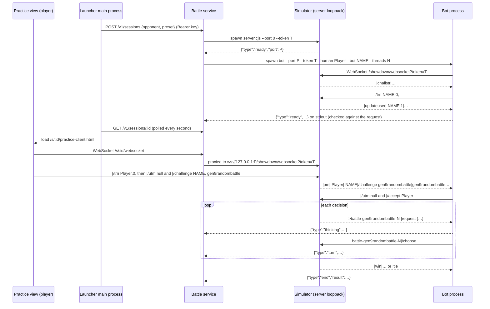

# Practice bots: how Foul Play and Laplace work

| | |
| --- | --- |
| **Status** | Living document. Describes v0.2.0. |
| **Owner** | Jayden |
| **Last reviewed** | 2026-11-12 |
| **Scope** | The two practice opponents, the engine they share, every protocol layer between the player and a bot's decision, performance, and how to run, test and host them. |
| **Related** | [Design document](design.md) · [Runtime sources](../vendor/laplace/SOURCE.md) |

This is the single reference for how the bots work. Other documents link here instead of repeating it.

## Contents

1. [Overview](#1-overview)
2. [Where the bots run](#2-where-the-bots-run)
3. [Protocols](#3-protocols)
4. [The shared search engine](#4-the-shared-search-engine-poke-engine-mcts)
5. [Foul Play](#5-foul-play)
6. [Laplace](#6-laplace)
7. [Performance](#7-performance)
8. [Running and hosting](#8-running-and-hosting)

## 1. Overview

Both bots play Gen 9 Random Battle (`gen9randombattle`) as real Showdown players: they log in to a private simulator, accept the player's challenge, read the standard battle protocol and send standard `/choose` commands. Neither bot sees hidden information. Both solve the hidden-information problem the same way, by **determinization**: fill in the opponent's unknown moves, item, ability and Tera type with plausible guesses ("worlds"), search each world with the same Rust engine as if it were fully known, and combine the results. They differ in how worlds are sampled, how much time each world gets, and what happens after the search.

| | Foul Play | Laplace |
| --- | --- | --- |
| Author, license | pmariglia, GPL-3.0 | Project owner, MIT |
| Pinned revision | `8f541f8` | `8b4173d` |
| Protocol client | Foul Play's own `websockets` client and battle parser | `poke-env` 0.15.0 |
| Engine | poke-engine 0.0.48 | poke-engine 0.0.47 |
| Worlds × time per decision | 4 × 50 ms early, else 2 × 100 ms | 8 × 150 ms |
| Set data | pkmn/randbats counted sets | Counted joint sets (same source) and usage feed |
| Unseen slots | Random species under team-generation rules | Random unseen species |
| Combining | Weighted sum of visit shares | Average of visit shares |
| After search | Random among options ≥ 75% of best | Guards, value re-rank, then random among un-vetoed options ≥ 90% of best |
| Tera | Like any move | Only as the top pick |
| Learned model | None | 368-feature MLP for near-ties |
| Rejected choice | Session ends | Counted; server default used and surfaced |
| Adapter | `scripts/bots/foulplay.py` | `scripts/laplace/runner.py` |

Presets set the engine's search threads and nothing else: **Quiet** 1, **Balanced** 2, **Full** 8 (default). They are CPU budgets, not difficulty levels.

## 2. Where the bots run

Players reach the bots only through the private **hosted battle service** (`scripts/bots/service.cjs`, deployed from `deploy/bots/`). Bots never run on a player's computer.

For every session the service creates one `PracticeRuntime` (`app/practice-runtime.js`), which starts two child processes on the server:

- a **simulator**: the pinned Showdown server (`scripts/laplace/server.cjs`), bound to `127.0.0.1` on an OS-chosen port and protected by a fresh 256-bit token;
- a **bot**: `python -I -B runner.py` (Laplace) or `foulplay.py --source <checkout>` (Foul Play), told the port, token, both names and the thread count.

The same `PracticeRuntime` can also run inside the desktop app. That path is kept for testing and for future self-hosting work, not as a player feature ([section 8](#development-and-self-hosting-harness)).



## 3. Protocols

Four layers sit between the player and a decision. Only the first crosses the internet.

### 3.1 Launcher ↔ battle service (HTTPS)

| Route | Purpose |
| --- | --- |
| `GET /healthz` | Process health only |
| `GET /v1/bots` | Available opponents |
| `POST /v1/sessions` | Body `{"opponent": "laplace" \| "foulplay", "preset": "quiet" \| "balanced" \| "full"}` → session ID (random 256-bit hex) |
| `GET /v1/sessions/:id` | Startup, failure, turn and result status |
| `DELETE /v1/sessions/:id` | Stop and clean up |
| `GET /s/:id/practice-client.html` | The patched classic client and its assets; the session ID is the capability |
| `WS /s/:id/websocket` | One player socket, proxied to that session's simulator |

- `/v1` calls need `Authorization: Bearer <operator key>`; the key stays in the launcher's main process. No CORS; `Host` and `Origin` must match the configured origin. Unknown body keys or query strings are rejected.
- The gateway forwards text frames only. A binary frame or more than 40 messages per second closes the socket (code 1008). Simulator frames are capped at 1 MiB.
- Sessions end after 1 hour total, 5 minutes idle, 2 minutes without a client, or 10 s after the client disconnects. Excess sessions get HTTP 429.

### 3.2 Showdown WebSocket protocol (player and bot ↔ simulator)

Both the player's client and the bot speak the standard [Pokémon Showdown protocol](https://github.com/smogon/pokemon-showdown/blob/master/PROTOCOL.md) to the same simulator. Client → server frames are `ROOMID|TEXT` (empty room for global commands). Server → client frames are newline-separated `|TYPE|…` lines, prefixed with `>ROOMID` when they belong to a room.

The simulator accepts a WebSocket only from `127.0.0.1`, with the exact `Host` header and the exact path `/showdown/websocket?token=<session token>`; every other HTTP request gets 404. There is no login server: unregistered names are accepted.

| Step | Direction | Messages |
| --- | --- | --- |
| Log in | server → bot | `\|challstr\|…` |
| | bot → server | `\|/trn Laplace,0,` or `\|/trn FoulPlay,0,` |
| | server → bot | `\|updateuser\| Laplace\|1\|…` (the `1` means named); the bot is now ready |
| Challenge | player → server | `\|/trn Player,0,`, then `\|/utm null` and `\|/challenge Laplace, gen9randombattle` (sent by `vendor/laplace/client-bootstrap.js`) |
| | server → bot | `\|pm\| Player\| Laplace\|/challenge gen9randombattle\|gen9randombattle\|…` |
| | bot → server | `\|/utm null` then `\|/accept Player` |
| Battle start | server → both | `>battle-gen9randombattle-N`, `\|init\|battle`, `\|title\|Player vs. Laplace`, team and `\|request\|{JSON}` |
| Decision | server → bot | `\|request\|{JSON}` with the legal options and request ID (`rqid`); `"wait": true` means no decision is due |
| | bot → server | Laplace (poke-env): `battle-…\|/choose move <moveid>[ terastallize]` or `\|/choose switch <species>` · Foul Play: `battle-…\|/choose move <moveid>[ terastallize]\|<rqid>` or `\|/switch <slot>\|<rqid>` |
| Rejection | server → bot | `\|error\|[Invalid choice] …` or `\|error\|[Unavailable choice] …` |
| Turn | server → both | Event lines (`\|move\|`, `\|switch\|`, `\|-damage\|`, `\|-terastallize\|` …) then `\|turn\|N` |
| End | server → both | `\|win\|<name>` or `\|tie`, then the room closes (`\|deinit`) |

Both adapters accept a challenge only if every field matches: sender `Player`, recipient the bot's own name, format `gen9randombattle`. Laplace additionally requires the battle room to appear within 15 s of accepting and its `|title|` to name exactly those two players. Foul Play's upstream `hf`, `gg` and `/timer on` messages are dropped, so the battle timer stays off.

### 3.3 Bot process ↔ supervisor (stdio)

The supervisor (`PracticeRuntime`) starts each bot with command-line arguments and reads **one JSON object per line** from its stdout. stderr carries upstream logs and is never parsed. Writing `stop` to stdin, or closing stdin, ends the process; Laplace also stops on SIGINT/SIGTERM.

| Argument | Laplace | Foul Play |
| --- | --- | --- |
| `--port` | 1024–65535 | 1024–65535 |
| `--token` | 32–128 hex chars | exactly 64 hex chars |
| `--bot` / `--human` | `Laplace` / `Player` (optional 10-hex suffix) | `FoulPlay` / `Player` |
| `--threads` | 1, 2, 4 or 8 | 1, 2 or 8 |
| other | `--check` verifies the runtime and exits | `--source <absolute path to checkout>` |

| Event | Fields | Meaning |
| --- | --- | --- |
| `ready` | Laplace: `protocol: 1, bot, human, format, threads, determinizations: 8, searchMs: 150` · Foul Play: `protocol: 1, opponent: "foulplay", bot, human, format, threads, searchMs: 100` | Logged in. The supervisor fails the session unless every field matches what it requested. |
| `battle` | `room` | Challenge accepted, battle room opened |
| `thinking` | `room, turn` | A decision is due |
| `turn` | `room, turn, elapsedMs`; Laplace adds `visits, worlds, fallback` | A choice was sent |
| `recovery` | `room, kind` (`rejected-choice` or `default-choice`), `rejectedChoices, defaultChoices` | Laplace only: the server rejected a choice or poke-env sent `/choose default` |
| `end` | `room, result` (`win`, `loss` or `tie`, from the **player's** side) | Battle finished |
| `checked` | `protocol, runtime` | Laplace `--check` only |
| `error` | `code` | Fatal. Laplace codes: `runtime-invalid`, `connection-failed`, `session-failed`, `invalid-message`, `login-rejected`, `login-lost`, `battle-lost`, `disconnected`. Foul Play: `foulplay-session-failed`. |

The supervisor ignores events whose `room` is not `battle-gen9randombattle-<digits>`, clamps numbers to sane ranges, and discards late events from an earlier session with a generation counter. The simulator speaks the same framing: its only event is `{"type":"ready","port":P}`.

### 3.4 Network confinement

Both adapters install a Python audit hook (`local_socket_only` in `runner.py`, reused by `foulplay.py`) that raises on any socket bind, connect, send or DNS lookup whose address is not `127.0.0.1`. They open a raw TCP socket to the simulator first and hand it to the WebSocket library, so no proxy setting or redirect can dial elsewhere. The simulator itself replaces outbound `Socket.connect` and `fetch` with functions that throw.

## 4. The shared search engine: poke-engine MCTS

Both bots call the same Rust function, `monte_carlo_tree_search(state, duration_ms, threads)`, on a fully specified battle state. It runs **decoupled UCT** for simultaneous moves:

1. **Select.** At each node, each side independently picks the option with the highest UCB1 score. The pair identifies a child group; one child is drawn in proportion to its probability (damage rolls, crits, accuracy and secondary effects are separate weighted branches) and its instructions are applied.
2. **Expand.** At the first unseen pair, `generate_instructions_from_move_pair` produces every chance outcome. Damage-roll branching is enabled only at the root and its children, to keep the tree small. One outcome is sampled.
3. **Evaluate.** No random playout. The leaf is scored with the engine's hand-written `evaluate(state)` (HP, boosts, status, hazards, side conditions and so on) relative to the root, through a sigmoid. A finished battle scores 1 or 0.
4. **Back-propagate.** The score is added to side one's chosen option, and its complement to side two's, at every node on the path.

$$
\mathrm{UCB1}(a) = \frac{Q(a)}{n(a)} + \sqrt{\frac{2 \ln N}{n(a)}}
\qquad
\text{score} = \sigma\big(\mathrm{eval}(\text{leaf}) - \mathrm{eval}(\text{root})\big),\quad
\sigma(x) = \frac{1}{1 + e^{-0.0125x}}
$$

Q is an option's total score, n its visits and N the parent's visits; unvisited options score infinity. The 0.0125 scale puts a 200-point evaluation lead close to 1.0. When time runs out, the engine returns each root option's visits and total score for both sides. With `threads > 1`, workers grow the tree in parallel. Both bots build poke-engine from source with Gen 9 Terastallization.

## 5. Foul Play

pmariglia's GPL-3.0 bot, pinned at [`8f541f8`](https://github.com/pmariglia/foul-play/tree/8f541f80f91f960603673796559f796b10ccf0fb). The project runs its battle parsing, inference, sampling, search and move formatting unchanged, and replaces only how it connects, logs and parallelizes.

**In one sentence:** sample 2–4 complete guesses of the opponent's team from real random-battle set counts, search each with poke-engine 0.0.48, sum the root visit shares, and choose randomly among moves within 75% of the best.

### One decision

1. **Parse and infer.** Foul Play keeps its own battle model, updated from every protocol line. After each turn, inference narrows what the opponent can hold:
   - **Speed ranges.** Moving first at equal priority sets a minimum speed (and the reverse a maximum), accounting for Trick Room and priority-changing effects.
   - **Choice Scarf**, **Heavy-Duty Boots** (hazard damage) and Hidden Power type checks.
   - **Reverse damage checks.** Damage dealt and taken is compared with the engine's rolls to rule out impossible items, abilities and spreads.
   - **Zoroark detection.** A move outside the visible Pokémon's possible sets, or an unexpected immunity, reveals Illusion.
2. **Choose the budget.** With parallelism 1 (the desktop setting): if 3 or fewer opposing Pokémon are revealed and the active one has shown no moves, sample **4 worlds × 50 ms**; otherwise **2 worlds × 100 ms**. The time-pressure branch never triggers because the desktop turns the battle timer off.
3. **Sample worlds.** For each revealed opposing Pokémon, list all complete sets from the hash-checked [`pkmn/randbats`](https://github.com/pkmn/randbats/tree/684abfaaba8e163532dfff73465c734e3432314a) data that match the evidence (revealed moves, ability, item, speed range, level, Tera type), relaxing to moves only if none remain. Each world draws one set per Pokémon, weighted by how often the generator produced it. Unrevealed slots are filled with random species and sets that respect Showdown's team rules (no duplicate species, at most 3 weak to one type, at most 2 of one type, at most one shared 4× weakness; up to 10 retries). `lock_moves` then restricts options for Choice lock, Assault Vest, first-turn-only moves, Taunt and multi-turn locks. Each world has weight 1/N.
4. **Search.** Each world is converted with `battle_to_poke_engine_state` and searched for the budgeted time with the preset's thread count.
5. **Combine and pick.** Sum each root option's weighted visit share, keep options with at least 75% of the best, and sample one in proportion to its share. Tera options compete like any other move.
6. **Send** `/choose move <moveid>` (with ` terastallize` when chosen) or `/switch <slot>`, followed by the request's `rqid` (section 3.2).

$$
P(a) = \sum_{w=1}^{N} \frac{1}{N}\cdot\frac{\mathrm{visits}_w(a)}{\mathrm{total\_visits}_w}
\qquad
\text{candidates} = \{\, a : P(a) \ge 0.75 \max P \,\}
$$

### Adapter (`scripts/bots/foulplay.py`)

- **Configuration:** `gen9randombattle`; search time 100 ms (team preview too); parallelism 1; threads 1 / 2 / 8 by preset; no Smogon stats download, no log file, no saved replays.
- **No orphaned processes.** Upstream searches worlds in a `ProcessPoolExecutor`; the adapter substitutes a `ThreadPoolExecutor`, so all search runs inside the one owned Python process.
- **Connection and challenges.** Loopback-only, logs in as `FoulPlay`, accepts only the matching challenge from `Player`, then runs upstream `pokemon_battle` to completion (section 3.2). `hf`, `gg` and `/timer on` are dropped.
- **Never silently weakened.** `[Invalid choice]` or `[Unavailable choice]` ends the session instead of falling back to random play. A second battle in one session is an error.
- **Telemetry and shutdown.** `thinking` on a non-wait `|request|`, `turn` with elapsed ms when a choice is sent (section 3.3); `stop` on stdin or a closed pipe exits immediately.
- Pinned Python packages are recorded in `scripts/bots/lock.json`. No claim is made about upstream ladder strength at this budget.

## 6. Laplace

The owner's MIT project, pinned at `8b4173d`. It peaked at 2231 Elo / ~83.3 GXE on the public Gen 9 Random Battle ladder; that figure is not claimed for this integration.

**In one sentence:** sample 8 complete guesses of the opponent's team, run 150 ms of MCTS on each in poke-engine 0.0.47, average the root visit shares, then pass the ranking through deterministic guards, a small learned value net and a mixed-strategy sampler.

### Components

| Component | File (Laplace repo) | Role |
| --- | --- | --- |
| `poke-env` 0.15.0 | dependency | Parses the Showdown protocol into a `Battle` object |
| `EnginePlayer` | `agent/engine_search.py` | The bot: one `choose_move(battle)` per decision |
| State builder | `agent/poke_engine_adapter.py` | Converts a `Battle` into a fully specified `poke_engine.State`, sampling hidden parts |
| `poke-engine` 0.0.47 | Rust, Gen 9 Tera | Exact Gen 9 mechanics, MCTS, one-ply `generate_instructions` |
| Value net | `value/net.py`, `value/value_features.py` | MLP 368 → 256 → 128 → 1, sigmoid = P(win) |
| Data | `JOINT_SETS`, `RANDBATS_STATS`, `RANDBATS_SETS` | Counted complete randbats sets (from Foul Play's public dataset), usage feed and set sheet |

### One decision

1. **Track evidence** that `poke-env` does not keep:
   - Moves the opposing active has used since switching in. One move plus a Choice item means locked; two different moves means not Choice.
   - **Choice Scarf from turn order.** Randbats spreads are fixed (85 EVs, 31 IVs, neutral nature), so raw Speed is effectively known. Moving first at equal priority when it should not (5% tolerance; Trick Room and Prankster excluded) marks `scarf`, which overrides `noscarf`, never the reverse.
   - **Heavy-Duty Boots from hazards.** Took Stealth Rock damage → not Boots. Switched into rocks and took none → Boots (barring Magic Guard). Hazards are tracked in protocol order.
   - Delayed effects: Wish (landing turn, amount) and Future Sight.
2. **Build 8 worlds.** Our side is exact, from the server's request. For each opposing Pokémon seen, a complete joint set (level, item, ability, 4 moves, Tera type) is drawn by generator frequency, narrowed in order by revealed moves, then known or inferred item, then known ability. Each filter applies only if some set survives, so stale data degrades to "less informed", never "no set". Unseen slots are filled to 6 with random unseen species and sampled sets.
3. **Search each world.** `monte_carlo_tree_search(state, 150 ms, threads=T)` runs sequentially per world. A world that makes the engine panic is skipped rather than losing the turn.
4. **Pool.** Each root option's visit share is averaged across successful worlds (`robust_vote=False`). Because joint sets are drawn in proportion to their counts, a uniform average is already likelihood-weighted.
5. **Guard and re-rank** in order: absorb → futility → damage tiebreak → value re-rank → no-op → dead-lock (table below).
6. **Mix.** From the top, take the unbroken run of un-vetoed options scoring at least 90% of the top (`mix_frac=0.9`); Tera options only as the top pick. If 2 or more remain, sample in proportion to score. If 3 or more are eligible and their scores span ≤ 0.03, the position is treated as noise and the ranked order stands.
7. **Play** the first ranked option that is legal now. If none is usable, play the highest-damage move (counted as a fallback and surfaced).

$$
\mathrm{score}(a) = \frac{1}{N}\sum_{w=1}^{N}\frac{\mathrm{visits}_w(a)}{\mathrm{total\_visits}_w}
$$

### Guards and re-rankers

| Stage | Fires when | Effect |
| --- | --- | --- |
| Absorb | An attack is certainly nullified by the opponent's revealed typing or absorb ability (or every surviving set agrees) | Demoted at any score gap and vetoed from the mix; stands down if nothing else remains |
| Futility | Repeated clicks of the same move in the same matchup were erased (opponent HP back to an earlier snapshot), or repeated self-boosts gained nothing | Demoted at any score gap |
| Damage tiebreak | Top two scores within 0.03 | Prefer the option that damages the revealed opponent; switches rank below damaging moves |
| Value re-rank | 2+ options within 0.11 of the top (top 3 considered; Tera only if already top) | See below |
| No-op | Against the opponent's likeliest reply, every chance outcome equals doing nothing (e.g. full-HP recovery, rocks onto rocks), polled over 3 worlds | Demoted below every option that does something |
| Dead-lock | Unlocked Choice item, no switches left, a status move on top while an attack also scored | Swap so the last Pokémon locks into an attack |

**Value re-rank.** For each near-tied candidate, in up to 4 searched worlds, Laplace takes the opponent's 2 most-visited replies and calls `generate_instructions(state, ours, theirs)`, which returns every chance branch with its probability. Each successor state is featurized into 368 numbers (field; per side: team aggregates, side conditions, active stats, status, boosts, item and ability flags, best damage into the opposing active, speed race; five canonically sorted bench blocks) and scored by the net. A candidate's value is the win probability weighted by reply visits × branch probability. If any candidate yields no valued successor, the re-rank stands down. Most turns skip it because no near-tie exists.

### Configuration (`scripts/laplace/runner.py`)

The runner refuses to start if versions or the model hash differ.

| Setting | Value |
| --- | --- |
| Worlds per decision | 8 (sequential) |
| Search time per world | 150 ms |
| Engine threads | Quiet 1 · Balanced 2 · Full 8 |
| Pooling | Plain average (`robust_vote=False`) |
| Mixed root | On, `mix_frac=0.9`, collapse eps 0.03 |
| Value net | SHA-256 `502a47a5…`, Torch 1 thread, margin 0.11, boost margin off |
| Guards | Absorb, futility, tiebreak, no-op, dead-lock on; gamble off |
| Versions | poke-env 0.15.0, poke-engine 0.0.47 |

*(snapshot)* On a 20-thread development CPU a warm decision takes a median 1.28 s (Quiet) to 1.64 s (Full). See [section 7](#7-performance).

**Connection.** `poke-env` parses every battle message into a `Battle` and calls `choose_move` on each request; the runner wraps its client to handle login, challenge filtering and telemetry (sections 3.2–3.3). A rejected choice is counted as a `recovery` event and poke-env's `/choose default` is sent instead. After each game all per-battle memory (poke-env battles and Laplace's evidence trackers) is cleared so a rematch starts fresh.

## 7. Performance

*(snapshot, 2026-11-10)* `scripts/laplace/benchmark.py` runs Laplace's full move-selection pipeline (set sampling, 8 × 150 ms search, pooling, guards, optional re-rank, order conversion) on three synthetic positions: an opening with unrevealed opponents, a midgame with hazards and a boosted opponent, and a forced switch. It creates no rooms and needs no server. Every one of the 192 decisions was legal, with no engine fallback.

| Logical CPUs | Search threads | Median wall, ms | Median CPU, ms | Median visits | Peak memory, MiB |
| ---: | ---: | ---: | ---: | ---: | ---: |
| 20 | 1 (Quiet) | 1,276 | 1,266 | 538,000 | 293 |
| 20 | 2 (Balanced) | 1,371 | 2,562 | 981,000 | 327 |
| 20 | 8 (Full) | 1,637 | 9,828 | 2,353,000 | 408 |
| 4 | 8 | 1,431 | 5,062 | 1,266,000 | 337 |
| 2 | 8 | 1,355 | 2,578 | 762,000 | 305 |

- **Host:** Intel Core i9-13900H (14 cores, 20 logical CPUs, 16 GiB), Windows 11, AC power. The 4- and 2-CPU rows use CPU affinity masks on the same chip. Each row is 15 warm decisions in a fresh process.
- **Measured build:** Python 3.12.16 Windows x64; poke-engine 0.0.47 for `x86_64-pc-windows-gnu` (Rust 1.96.0, GCC 13.2.0); runtime manifest SHA-256 `e83e0864…`, engine binary `55da8bd3…`, value model `502a47a5…`.
- **Cold start:** 3.19 s median to a loaded agent, 2.22 s of it Torch and feature imports. The first decision then takes 1.41 s median.
- **Value re-rank:** skipped by all 180 warm decisions (no near-tie). Forced on a three-way tie, it costs 16–31 ms over 45–87 successor states; the net's forward pass is under 0.4 ms of that.
- **What it means for hosting.** Search is time-limited, so fewer CPUs give similar wall times but shallower search: Full collects 46% fewer visits on 4 CPUs and 68% fewer on 2. The service's initial cap of 4 CPUs per container therefore limits Full. Size the real service VM by measurement.
- **What it does not mean.** Timings and visits measure compute cost only. Playing strength needs controlled matches with paired seeds and uncertainty intervals; none have been completed.

Reproduce with the staged runtime and the pinned Laplace checkout (writes ignored `out/laplace/benchmark.json`; `--repeats 1` for a short run):

```powershell
& '.\vendor\laplace\dist\python\python.exe' -I -B scripts/laplace/benchmark.py --laplace-root '<path to the Laplace checkout>'
```

## 8. Running and hosting

### Pins

| Component | Pin |
| --- | --- |
| Laplace | `8b4173d`, MIT; model SHA-256 `502a47a5…`; poke-env 0.15.0, NumPy 2.4.6, Torch 2.12.0+cpu |
| poke-engine (Laplace) | 0.0.47 from hashed sdist, Rust 1.96.0, Gen 9 Tera feature |
| Foul Play | `8f541f8`, GPL-3.0; poke-engine 0.0.48; separate Python environment (`scripts/bots/lock.json`) |
| Random-battle data (Foul Play) | `pkmn/randbats` `684abfa`, SHA-256 in `scripts/bots/lock.json` |
| Showdown simulator | `smogon/pokemon-showdown` `a9caa4c`, MIT |
| Classic client (practice view) | `smogon/pokemon-showdown-client` `49b5420`, AGPL-3.0, recorded patches |
| Python | 3.12.16 (Windows standalone for the harness; `python:3.12.16-slim-bookworm` in the service image) |

Source, license and build records: [`vendor/laplace/SOURCE.md`](../vendor/laplace/SOURCE.md). Manifests detect corruption; they are not publisher signatures.

### Development setup

Players never run these steps. Prerequisites: Node 24, Python 3.12, Git, a Rust toolchain, and on Windows the compiler listed in `vendor/laplace/SOURCE.md`.

```powershell
npm ci
npm run build:practice      # Laplace runtime under ignored vendor/laplace/dist/
npm run bots:setup -- --runtime "$PWD\vendor\laplace\dist"
```

`bots:setup` clones pinned Foul Play, builds its engine in its own Python environment, downloads hash-checked set data, checks both engines, and writes `out/bots/config.json` and `integrity.json` (override with `SHOWDOWN_BOT_CONFIG`). Do not run it while sessions are active. Generated files stay out of Git.

### Development and self-hosting harness

The desktop app can start a `PracticeRuntime` itself, with simulator and bot on the developer's machine. This path is **not a player feature**. It is kept to prove the bots work end to end and as the base for hosting the service ourselves. It uses the protocols in section 3 without the HTTPS layer. A development launcher uses it whenever `SHOWDOWN_BOT_SERVICE_URL` and `SHOWDOWN_BOT_SERVICE_KEY` are unset.

To exercise the real service path instead, run the service and point the launcher at it:

```powershell
# Terminal 1
$env:BOT_SERVICE_KEY = '<random secret, at least 32 characters>'
npm run bots:serve                     # listens on 127.0.0.1:8787
# Terminal 2
$env:SHOWDOWN_BOT_SERVICE_URL = 'http://127.0.0.1:8787'
$env:SHOWDOWN_BOT_SERVICE_KEY = '<the same secret>'
npm start
```

| Command | Covers |
| --- | --- |
| `npm run test:practice` | A real Laplace battle through the desktop: move, switch, Tera, navigation, Stop, Forfeit, rematch, renderer-crash cleanup |
| `npm run test:bots` | Real Electron games for both bots, direct and through the service, both themes and window sizes |
| `tests/bots-games.py` (run with the runtime's Python) | Two complete games per bot against a heuristic player; result agreement and pipe shutdown |
| `npm run smoke:practice-packaged` | A harness game inside an unpacked package, including a relocated copy |

All of these use disposable profiles and private servers, never the player's account or the public server. They are integration checks, not strength benchmarks. Test windows run with `SHOWDOWN_DESKTOP_BACKGROUND=1` (non-focusing, transparent, ignores the mouse).

### Deploying the service

`deploy/bots/Dockerfile` builds a Linux x64 image (both engines compiled in it); `deploy/bots/compose.yaml` runs one service behind Caddy HTTPS.

```sh
export BOT_DOMAIN=bots.example.org
export BOT_SERVICE_KEY='<new long random secret>'
export BOT_MAX_SESSIONS=1
docker compose -f deploy/bots/compose.yaml build
docker compose -f deploy/bots/compose.yaml up -d
```

- Point DNS at the host and open only TCP 80 and 443. Keep 8787 and simulator ports private. `BOT_SERVICE_ORIGIN` is the exact external HTTPS origin, and the proxy must preserve `Host` (the supplied Caddyfile does, and supports WebSocket upgrades).
- Caddy has no access log because session URLs are capability tokens.
- Testers set `SHOWDOWN_BOT_SERVICE_URL=https://bots.example.org` and the shared key. Never put the key in a public build.
- Initial caps: 1 session, 4 CPUs, 4 GiB, 128 processes. These are starting limits, not measured recommendations (see section 7).
- One replica only: sessions live in memory, so a restart ends every battle. There is no persistence, resume, queue, horizontal routing, per-user credentials or quotas yet.
- **Not yet verified:** the Linux image build, Caddy certificate issuance, cloud firewall rules and Linux native-library portability. Do this before inviting anyone.
