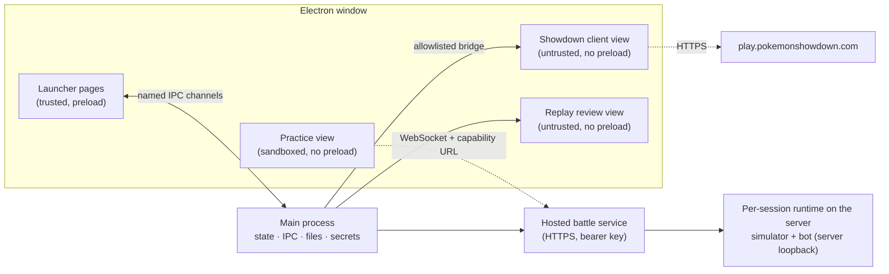

# Showdown Desktop: design

| | |
| --- | --- |
| **Status** | Living document. Describes v0.2.0 (`main` at `bc5ec62`). |
| **Last reviewed** | 2026-11-12 |
| **Scope** | The whole app: launcher shell, Showdown bridge, replay notes, Showdex, hosted battle service, and the two practice bots (Foul Play and Laplace). |
| **Related** | [Playable bots](playable-bots.md) · [Laplace performance](laplace-performance.md) · [Replay review](replay-review.md) · [Replay backups](replay-backups.md) · [Windows delivery](windows.md) |

This document explains *what* the app is, *how* it is built, and *why* the main decisions were made. Setup steps, measurements and checklists live in the related documents; this one links to them rather than repeating them. Figures marked *(snapshot)* were true on the date above and are expected to drift.

## Contents

1. [Context](#1-context)
2. [Goals and non-goals](#2-goals-and-non-goals)
3. [Architecture](#3-architecture)
4. [Features](#4-features)
5. [Hosted practice service](#5-hosted-practice-service)
6. [The shared search engine](#6-the-shared-search-engine-poke-engine-mcts)
7. [Foul Play](#7-foul-play)
8. [Laplace](#8-laplace)
9. [Key decisions](#9-key-decisions)
10. [Security and privacy](#10-security-and-privacy)
11. [Testing](#11-testing)
12. [Build and packaging](#12-build-and-packaging)
13. [Risks and open questions](#13-risks-and-open-questions)
14. [Appendix: visual design tokens](#appendix-visual-design-tokens)

## 1. Context

Pokémon Showdown is played in a browser tab. A tab loses its place among other tabs, gives tools such as damage calculators and replay notes no stable home, and offers no safe way to practise against strong bots: any automated play on the public server uses a real account and the public ladder.

Showdown Desktop is an Electron 45 / Node 24 app that hosts the **unmodified** official client in a dedicated window, adds a launcher shell and tools around it, and runs bot practice on a **private** simulator that never touches the player's account.

**Audience.** Competitive Showdown players who want one app window that keeps their session and tools together, and who want to practise against strong engines without touching their online account.

## 2. Goals and non-goals

**Goals**

- G1. A downloadable Windows app that installs and runs with no development tools.
- G2. The official client stays fully playable at all times. Every added layer fails safe back to plain Showdown.
- G3. Add value around the client: a home hub, replay notes and in-app review, an optional damage calculator, and bot practice.
- G4. Practise against strong engines (Laplace and Foul Play) through a private hosted battle service.
- G5. A distinctive visual identity: cobalt light and steel-blue dark themes, flat and colorful.

**Non-goals**

- Forking or re-implementing the Showdown client or battle simulator.
- Running bots on the player's computer. Practice is service-only (owner decision, 2026-11-12).
- Automating play on the user's real account. The app never searches, challenges or plays by itself, and tests use simulated sessions.
- Hosting replays. Showdown hosts them; the app stores only links and notes.
- Rating bots as Elo players. Practice settings are computation budgets, not skill levels.

**Priority.** Features first. Clean-machine installation, signing, licensing and public release come last.

## 3. Architecture

One Electron window hosts three kinds of web content with different trust levels. The main process owns all state, files, child processes and secrets.

### Components

| Part | Where | Trust and isolation |
| --- | --- | --- |
| Main process (`app/main.js`) | Electron main | Owns windows, IPC, settings, replay storage, logs, practice lifecycle and the service key |
| Launcher pages (`renderer/*.html`) | `BrowserWindow` | Get `window.desktop` from `app/preload.js`; every call is a named IPC channel |
| Showdown client view | `WebContentsView`, partition `persist:showdown` | Loads `play.pokemonshowdown.com`; no preload, no Node; themed by injected CSS; popups only for Google sign-in |
| Showdown bridge (`app/showdown.js`) | Main, runs functions in the client page | Reads a sanitized snapshot (user, formats, teams, news, rooms, friends) and sends allowlisted actions: search, cancel, challenge, join, focus, leave, edit team, login |
| Practice view (`app/practice-view.js`) | `WebContentsView` | Patched classic client; no preload, no Node; connects only to its hosted practice session |
| Replay review (`app/replay-review.js`) | `WebContentsView` | Official replay player beside the note editor |
| Showdex (`app/showdex-integration.js`) | Custom scheme inside the client view | Optional pinned build, verified by SHA-256 manifest |
| Hosted practice (`app/hosted-practice.js` ↔ `scripts/bots/service.cjs`) | Remote service | Bearer-key REST and per-session WebSocket gateway. Each session runs a `PracticeRuntime` (simulator and bot child processes, loopback only) on the server |

### Data flow

- **Online play.** Launcher pages ask main for a snapshot. Main runs `readClient()` inside the Showdown page and sanitizes the result (IDs by regex, strings length-capped, sprite paths checked). Actions go the other way, validated against an allowlist, with arguments passed as JSON and never spliced into code. When a battle room opens, the launcher switches to the client view.
- **Practice.** The Practice page asks main to start a session with an opponent and preset. Main's `HostedPractice` creates the session on the battle service with the operator key and polls its status. Once the bot is ready, the practice view loads from the session's capability URL and talks to the server only through that session's WebSocket gateway.
- **Storage.** Settings, window state and `replays.json` live in Electron's userData folder (`%APPDATA%/showdown-desktop`), written atomically (temp file, then rename). Showdown's own login, teams and preferences live in the `persist:showdown` partition, separate from launcher data. Logs record fixed event names and numeric codes only.

### Repository layout

| Path | Contents |
| --- | --- |
| `app/` | Main-process modules, preload, injected client/replay/Showdex CSS |
| `renderer/` | Launcher pages: Home, Showdown, Practice, Replays, Settings, shared nav and styles |
| `scripts/laplace/` | Laplace build scripts, simulator wrapper, Python runner, benchmark (used on the service host) |
| `scripts/bots/` | Foul Play setup, adapter, hosted battle service, bot test driver, source lock |
| `vendor/laplace/`, `vendor/showdex/` | Source pins, licenses, runtime lock, patched practice client shell |
| `deploy/bots/` | Dockerfile, Compose file and Caddyfile for the hosted service |
| `tests/` | Node unit tests, Python runner tests, Electron desktop and live smoke drivers |
| `docs/` | Feature, performance, packaging and hosting documentation |

## 4. Features

Six user-facing areas: Home, the Showdown client, Practice, Replay notes and review, Showdex, and Settings. Each degrades to plain Showdown when it fails (G2).

**Launcher shell and navigation**

- Left rail: Home, Showdown, Practice, Replay notes, Settings. A Showdown section lists open rooms (battles, chats, teambuilder, ladder) and a **Join a room** button; it appears only while rooms are open.
- The client stays loaded across page changes, so navigating never loses a live battle.
- A newly started battle switches to the Showdown view and takes priority over other pages. Home shows a **Return to battle** banner while one is running.
- Fail-safe shell: if the launcher cannot drive rooms, the client's own tabs are restored.

**Home hub**

- Cobalt battle hero: format picker, team picker with sprites of the selected team, **Battle** (search), **Cancel**, **Challenge a user**. Searching shows an animated state and runs in the background.
- Account status and ratings (cached 2 minutes), user and battle counts.
- Tiles for Teambuilder and Watch a battle, the latest three Showdown news posts, chat rooms, recent replay notes.
- Friends panel from structured presence data (online, idle, busy, offline as reported), refreshed at most every 30 s, with **Open friends list** as fallback. No battle links or avatars are inferred.

**Showdown client**

- The official client in a persistent partition, so sign-in survives restarts.
- Injected cobalt-light / steel-blue-dark theme that preserves Pokémon type, HP and stat colors.
- External links open in the system browser; only Google sign-in may open a popup.

**Practice against bots**

- Gen 9 Random Battle against **Laplace** or **Foul Play**.
- Presets **Quiet** (1 search thread), **Balanced** (2) and **Full** (8, default). These are CPU budgets, not difficulty levels.
- Moves, switching, Terastallization, Forfeit, rematch (**Next battle**) and explicit **Stop practice…**. Status shows starting, ready, thinking, turn, elapsed time and result.
- Runs on the private hosted battle service; nothing is installed or computed on the player's PC. Online and practice games stay loaded side by side.

**Replay notes and review** (details: [replay-review.md](replay-review.md), [replay-backups.md](replay-backups.md))

- Save a replay link with title, format and notes (title 120 chars, notes 5,000, up to 1,000 entries / 8 MiB). **Save replay note** on a battle prefills players and format.
- Search by title, format and note text; **Ctrl+F**, **Escape**, **Ctrl+S**. Duplicate links offer the existing note.
- **Review replay** shows the official replay player beside the note editor. Unsaved drafts survive navigation.
- **Export notes…** to JSON; **Import notes…** with a review step, per-note conflict choice, and **Undo import…** until notes change or the app restarts.

**Showdex (optional)**

- Pinned Showdex 1.4.2 with a recorded readiness patch, verified against a committed SHA-256 manifest. Enabled in Settings; takes effect only after an explicit client reload.
- Themed to match the app while keeping calculator colors. Excluded from packaged builds until its distribution licensing is decided.

**Settings**

- Appearance (system, light, dark), start page, confirm on close, Showdex toggle, explicit client reload, open logs.
- **Sign out** clears the Showdown partition (including local teams). **Reset launcher** clears settings, preferences and replay notes but keeps the Showdown session. Both confirm first.
- Window size, position and maximized state are remembered, and repositioned if a monitor disappears.

## 5. Hosted practice service

Every practice game is a real Showdown battle on a private simulator, run on the battle service, that only the player's session and one bot can reach. Setup and hosting steps: [playable-bots.md](playable-bots.md).

### Session lifecycle on the server (`app/practice-runtime.js`)

The service creates one `PracticeRuntime` per session:

1. **Validate.** Opponent is `laplace` or `foulplay` (Foul Play only if configured); preset is `quiet`, `balanced` or `full`; no session is running.
2. **Mint identities.** A fresh 256-bit hex token; fixed names `Player` and `Laplace` or `FoulPlay`. A 120 s startup timeout starts.
3. **Verify the runtime.** A worker thread checks every payload file's size and SHA-256 against the v2 manifest. Foul Play has its own recorded inventory. Stop cancels verification.
4. **Start the simulator.** `server.cjs` runs under Electron's Node (`ELECTRON_RUN_AS_NODE`) on an OS-chosen port bound to `127.0.0.1` and reports `{type: "ready", port}`.
5. **Start the bot.** `python -I -B runner.py` (or `foulplay.py --source …`) with port, token, names and thread count, at below-normal priority with a minimal environment (`OMP_NUM_THREADS=1`, `MKL_NUM_THREADS=1`).
6. **Check the handshake.** The bot's `ready` event must echo the exact protocol, names, format, thread count and search settings (Laplace: 8 worlds, 150 ms; Foul Play: 100 ms). Any mismatch fails the session.
7. **Play.** The player's practice view loads the patched classic client from the service, connects through the gateway and challenges the bot. Bot events reach the Practice page through session status.
8. **Stop.** Stop, failure, client disconnection or expiry ends both children (stdin closed, then killed). A `generation` counter discards late events from an old session.

### Simulator hardening (`scripts/laplace/server.cjs`)

- Pinned Showdown server `a9caa4c`, loaded with an in-memory config: loopback bind, no subprocesses, file writes, network requests, login server, ladder or logging.
- Outbound `Socket.connect` and `fetch` are replaced with functions that throw.
- Plain HTTP requests get 404. A WebSocket upgrade is accepted only from `127.0.0.1` with the exact `Host` header and `/showdown/websocket?token=<token>` path.
- stdout is reserved for the JSON protocol; upstream logging goes to stderr. The server exits when the parent pipe closes.

### Practice client and view

- The classic Showdown client (AGPL-3.0, pinned `49b5420`) is built with recorded, anchor-checked patches: connect straight to the practice socket, skip the public server, keep navigation inside the room, adjust Forfeit and close-room behavior. Rendering and controls stay upstream.
- `client-bootstrap.js` validates the session address and names before anything loads.
- The view is sandboxed with context isolation, no Node and no preload. All permission requests are denied. Requests are allowed only to the session's own client files and server and official Showdown artwork; audio, downloads, popups and arbitrary navigation are blocked.

### Hosted service (`scripts/bots/service.cjs`)

The service wraps the same `PracticeRuntime` per session behind HTTPS. The launcher's `HostedPractice` polls it every second and keeps the operator key in the main process only.

| Route | Purpose |
| --- | --- |
| `GET /healthz` | Process health only |
| `GET /v1/bots` | Available opponents |
| `POST /v1/sessions` | `{opponent, preset}` → session ID (random 256-bit) |
| `GET /v1/sessions/:id` | Startup, failure, turn and result status |
| `DELETE /v1/sessions/:id` | Stop and clean up |
| `GET /s/:id/practice-client.html` | Capability-protected client and assets |
| `WS /s/:id/websocket` | One player socket, proxied to that session's loopback simulator |

- All `/v1` calls need `Authorization: Bearer <key>`; no CORS. `Host` and `Origin` must match the configured origin.
- The WebSocket proxy rejects binary frames and more than 40 messages per second.
- A session is removed after 1 hour total, 5 minutes idle, 2 minutes without a client, or 10 s after its client disconnects. Excess sessions get HTTP 429.
- `deploy/bots/` builds a Linux x64 image behind Caddy HTTPS with initial caps of 1 session, 4 CPUs, 4 GiB and 128 processes. Caddy keeps no access log because URLs carry capability tokens. Only ports 80 and 443 are public.
- Not built: persistence, resume after restart, queueing, horizontal routing, per-user credentials and quotas.

### Pins

| Component | Pin |
| --- | --- |
| Python | 3.12.16 (`python:3.12.16-slim-bookworm` service image) |
| Laplace | `8b4173d`, MIT; model SHA-256 `502a47a5…` |
| poke-engine (Laplace) | 0.0.47 from hashed sdist, Rust 1.96.0, Tera feature |
| Foul Play | `8f541f8`, GPL-3.0; poke-engine 0.0.48; separate venv |
| Random-battle data (Foul Play) | `pkmn/randbats` `684abfa`, SHA-256 in `scripts/bots/lock.json` |
| Showdown simulator | `smogon/pokemon-showdown` `a9caa4c`, MIT |
| Classic client | `smogon/pokemon-showdown-client` `49b5420`, AGPL-3.0 |

## 6. The shared search engine: poke-engine MCTS

Both bots call the same Rust function, `monte_carlo_tree_search(state, duration_ms, threads)`, on a fully specified battle state. It runs **decoupled UCT** for simultaneous moves:

1. **Select.** At each node, each side independently picks the option with the highest UCB1 score. The pair identifies a child group; one child is drawn in proportion to its probability (damage rolls, crits, accuracy and secondary effects are separate weighted branches) and its instructions are applied.
2. **Expand.** At the first unseen pair, `generate_instructions_from_move_pair` produces every chance outcome. Damage-roll branching is enabled only at the root and its children, to keep the tree small. One outcome is sampled.
3. **Evaluate.** No random playout. The leaf is scored with the engine's hand-written `evaluate(state)` (HP, boosts, status, hazards, side conditions and so on) relative to the root, through a sigmoid. A finished battle scores 1 or 0.
4. **Back-propagate.** The score is added to side one's chosen option, and its complement to side two's, at every node on the path.

$$
\mathrm{UCB1}(a) = \frac{Q(a)}{n(a)} + \sqrt{\frac{2 \ln N}{n(a)}}
\qquad
\text{score} = \sigma\big(\mathrm{eval}(\text{leaf}) - \mathrm{eval}(\text{root})\big),\quad
\sigma(x) = \frac{1}{1 + e^{-0.0125x}}
$$

Q is an option's total score, n its visits and N the parent's visits; unvisited options score infinity. The 0.0125 scale puts a 200-point evaluation lead close to 1.0. When time runs out, the engine returns each root option's visits and total score for both sides. With `threads > 1`, workers grow the tree in parallel. Both bots build poke-engine from source with Gen 9 Terastallization.

Because Random Battle hides the opponent's moves, item, ability and Tera type, both bots use **determinization**: fill in the unknowns with plausible guesses ("worlds"), search each world as if it were fully known, and combine the root statistics. They differ in how worlds are sampled, how much time each gets, and what happens after the search.

## 7. Foul Play

pmariglia's GPL-3.0 bot, pinned at [`8f541f8`](https://github.com/pmariglia/foul-play/tree/8f541f80f91f960603673796559f796b10ccf0fb). The desktop runs its battle parsing, inference, sampling, search and move formatting unchanged, and replaces only how it connects, logs and parallelizes.

**In one sentence:** sample 2–4 complete guesses of the opponent's team from real random-battle set counts, search each with poke-engine 0.0.48, sum the root visit shares, and choose randomly among moves within 75% of the best.

### One decision

1. **Parse and infer.** Foul Play keeps its own battle model, updated from every protocol line. After each turn, inference narrows what the opponent can hold:
   - **Speed ranges.** Moving first at equal priority sets a minimum speed (and the reverse a maximum), accounting for Trick Room and priority-changing effects.
   - **Choice Scarf**, **Heavy-Duty Boots** (hazard damage) and Hidden Power type checks.
   - **Reverse damage checks.** Damage dealt and taken is compared with the engine's rolls to rule out impossible items, abilities and spreads.
   - **Zoroark detection.** A move outside the visible Pokémon's possible sets, or an unexpected immunity, reveals Illusion.
2. **Choose the budget.** With parallelism 1 (the desktop setting): if 3 or fewer opposing Pokémon are revealed and the active one has shown no moves, sample **4 worlds × 50 ms**; otherwise **2 worlds × 100 ms**. The time-pressure branch never triggers because the desktop turns the battle timer off.
3. **Sample worlds.** For each revealed opposing Pokémon, list all complete sets from the hash-checked [`pkmn/randbats`](https://github.com/pkmn/randbats/tree/684abfaaba8e163532dfff73465c734e3432314a) data that match the evidence (revealed moves, ability, item, speed range, level, Tera type), relaxing to moves only if none remain. Each world draws one set per Pokémon, weighted by how often the generator produced it. Unrevealed slots are filled with random species and sets that respect Showdown's team rules (no duplicate species, at most 3 weak to one type, at most 2 of one type, at most one shared 4× weakness; up to 10 retries). `lock_moves` then restricts options for Choice lock, Assault Vest, first-turn-only moves, Taunt and multi-turn locks. Each world has weight 1/N.
4. **Search.** Each world is converted with `battle_to_poke_engine_state` and searched for the budgeted time with the preset's thread count.
5. **Combine and pick.** Sum each root option's weighted visit share, keep options with at least 75% of the best, and sample one in proportion to its share. Tera options compete like any other move.
6. **Send** `/choose move N` (with `terastallize` when chosen) or `/choose switch N`.

$$
P(a) = \sum_{w=1}^{N} \frac{1}{N}\cdot\frac{\mathrm{visits}_w(a)}{\mathrm{total\_visits}_w}
\qquad
\text{candidates} = \{\, a : P(a) \ge 0.75 \max P \,\}
$$

### Desktop adapter (`scripts/bots/foulplay.py`)

- **Configuration:** `gen9randombattle`; search time 100 ms (team preview too); parallelism 1; threads 1 / 2 / 8 by preset; no Smogon stats download, no log file, no saved replays.
- **No orphaned processes.** Upstream searches worlds in a `ProcessPoolExecutor`; the adapter substitutes a `ThreadPoolExecutor`, so all search runs inside the one owned Python process.
- **Connection.** Same loopback-only audit hook as Laplace; pre-connects a raw socket to `127.0.0.1`, logs in with `/trn FoulPlay,0,`, waits for `updateuser`, emits `ready`.
- **Challenges.** Accepts only a `/challenge gen9randombattle` PM from `Player`, runs upstream `pokemon_battle` to completion, emits `end` with win, loss or tie.
- **Chat and timer suppressed.** `hf`, `gg` and `/timer on` are dropped.
- **Never silently weakened.** `[Invalid choice]` or `[Unavailable choice]` ends the session instead of falling back to random play. A second battle in one session is an error.
- **Telemetry and shutdown.** `thinking` on a non-wait request, `turn` with elapsed ms on `/choose`; `stop` on stdin or a closed parent pipe exits immediately.
- Pinned Python packages are recorded in `scripts/bots/lock.json`. No claim is made about upstream ladder strength at this budget.

## 8. Laplace

The owner's MIT project, pinned at `8b4173d`. It peaked at 2231 Elo / ~83.3 GXE on the public Gen 9 Random Battle ladder; that figure is not claimed for this integration.

**In one sentence:** sample 8 complete guesses of the opponent's team, run 150 ms of MCTS on each in poke-engine 0.0.47, average the root visit shares, then pass the ranking through deterministic guards, a small learned value net and a mixed-strategy sampler.

### Components

| Component | File (Laplace repo) | Role |
| --- | --- | --- |
| `poke-env` 0.15.0 | dependency | Parses the Showdown protocol into a `Battle` object |
| `EnginePlayer` | `agent/engine_search.py` | The bot: one `choose_move(battle)` per decision |
| State builder | `agent/poke_engine_adapter.py` | Converts a `Battle` into a fully specified `poke_engine.State`, sampling hidden parts |
| `poke-engine` 0.0.47 | Rust, Gen 9 Tera | Exact Gen 9 mechanics, MCTS, one-ply `generate_instructions` |
| Value net | `value/net.py`, `value/value_features.py` | MLP 368 → 256 → 128 → 1, sigmoid = P(win) |
| Data | `JOINT_SETS`, `RANDBATS_STATS`, `RANDBATS_SETS` | Counted complete randbats sets (from Foul Play's public dataset), usage feed and set sheet |

### One decision

1. **Track evidence** that `poke-env` does not keep:
   - Moves the opposing active has used since switching in. One move plus a Choice item means locked; two different moves means not Choice.
   - **Choice Scarf from turn order.** Randbats spreads are fixed (85 EVs, 31 IVs, neutral nature), so raw Speed is effectively known. Moving first at equal priority when it should not (5% tolerance; Trick Room and Prankster excluded) marks `scarf`, which overrides `noscarf`, never the reverse.
   - **Heavy-Duty Boots from hazards.** Took Stealth Rock damage → not Boots. Switched into rocks and took none → Boots (barring Magic Guard). Hazards are tracked in protocol order.
   - Delayed effects: Wish (landing turn, amount) and Future Sight.
2. **Build 8 worlds.** Our side is exact, from the server's request. For each opposing Pokémon seen, a complete joint set (level, item, ability, 4 moves, Tera type) is drawn by generator frequency, narrowed in order by revealed moves, then known or inferred item, then known ability. Each filter applies only if some set survives, so stale data degrades to "less informed", never "no set". Unseen slots are filled to 6 with random unseen species and sampled sets.
3. **Search each world.** `monte_carlo_tree_search(state, 150 ms, threads=T)` runs sequentially per world. A world that makes the engine panic is skipped rather than losing the turn.
4. **Pool.** Each root option's visit share is averaged across successful worlds (`robust_vote=False`). Because joint sets are drawn in proportion to their counts, a uniform average is already likelihood-weighted.
5. **Guard and re-rank** in order: absorb → futility → damage tiebreak → value re-rank → no-op → dead-lock (table below).
6. **Mix.** From the top, take the unbroken run of un-vetoed options scoring at least 90% of the top (`mix_frac=0.9`); Tera options only as the top pick. If 2 or more remain, sample in proportion to score. If 3 or more are eligible and their scores span ≤ 0.03, the position is treated as noise and the ranked order stands.
7. **Play** the first ranked option that is legal now. If none is usable, play the highest-damage move (counted as a fallback and surfaced).

$$
\mathrm{score}(a) = \frac{1}{N}\sum_{w=1}^{N}\frac{\mathrm{visits}_w(a)}{\mathrm{total\_visits}_w}
$$

### Guards and re-rankers

| Stage | Fires when | Effect |
| --- | --- | --- |
| Absorb | An attack is certainly nullified by the opponent's revealed typing or absorb ability (or every surviving set agrees) | Demoted at any score gap and vetoed from the mix; stands down if nothing else remains |
| Futility | Repeated clicks of the same move in the same matchup were erased (opponent HP back to an earlier snapshot), or repeated self-boosts gained nothing | Demoted at any score gap |
| Damage tiebreak | Top two scores within 0.03 | Prefer the option that damages the revealed opponent; switches rank below damaging moves |
| Value re-rank | 2+ options within 0.11 of the top (top 3 considered; Tera only if already top) | See below |
| No-op | Against the opponent's likeliest reply, every chance outcome equals doing nothing (e.g. full-HP recovery, rocks onto rocks), polled over 3 worlds | Demoted below every option that does something |
| Dead-lock | Unlocked Choice item, no switches left, a status move on top while an attack also scored | Swap so the last Pokémon locks into an attack |

**Value re-rank.** For each near-tied candidate, in up to 4 searched worlds, Laplace takes the opponent's 2 most-visited replies and calls `generate_instructions(state, ours, theirs)`, which returns every chance branch with its probability. Each successor state is featurized into 368 numbers (field; per side: team aggregates, side conditions, active stats, status, boosts, item and ability flags, best damage into the opposing active, speed race; five canonically sorted bench blocks) and scored by the net. A candidate's value is the win probability weighted by reply visits × branch probability. If any candidate yields no valued successor, the re-rank stands down. Most turns skip it because no near-tie exists.

### Desktop configuration (`scripts/laplace/runner.py`)

The runner refuses to start if versions or the model hash differ.

| Setting | Value |
| --- | --- |
| Worlds per decision | 8 (sequential) |
| Search time per world | 150 ms |
| Engine threads | Quiet 1 · Balanced 2 · Full 8 |
| Pooling | Plain average (`robust_vote=False`) |
| Mixed root | On, `mix_frac=0.9`, collapse eps 0.03 |
| Value net | SHA-256 `502a47a5…`, Torch 1 thread, margin 0.11, boost margin off |
| Guards | Absorb, futility, tiebreak, no-op, dead-lock on; gamble off |
| Versions | poke-env 0.15.0, poke-engine 0.0.47 |

*(snapshot)* On a 20-thread development CPU a warm decision takes a median 1.28 s (Quiet) to 1.64 s (Full). See [laplace-performance.md](laplace-performance.md).

**Connection.** A Python audit hook rejects any socket bind, connect or DNS lookup that is not `127.0.0.1`. The runner pre-connects a raw socket to the simulator, logs in with `/trn Laplace,0,`, and accepts only a `gen9randombattle` challenge from `Player`, within 15 s, for a room whose title matches. Telemetry (`thinking`, `turn`, `recovery`) is one JSON line per event on stdout. Per-battle memory is cleared after each game. `stop` on stdin, SIGINT/SIGTERM or a closed parent pipe ends the process.

### Foul Play and Laplace compared

| | Foul Play | Laplace |
| --- | --- | --- |
| License | GPL-3.0 | MIT |
| Engine | poke-engine 0.0.48 | poke-engine 0.0.47 |
| Worlds × time per decision | 4 × 50 ms early, else 2 × 100 ms | 8 × 150 ms |
| Set data | pkmn/randbats counted sets | Counted joint sets (same source) and usage feed |
| Unseen slots | Random species under team-generation rules | Random unseen species |
| Combining | Weighted sum of visit shares | Average of visit shares |
| After search | Random among options ≥ 75% of best | Guards, value re-rank, then random among un-vetoed options ≥ 90% of best |
| Tera | Like any move | Only as the top pick |
| Learned model | None | 368-feature MLP for near-ties |
| Rejected choice | Session ends | Counted; server default used and surfaced |

## 9. Key decisions

Each entry records the choice, the alternative it was weighed against, and why.

| # | Decision | Alternative | Rationale |
| --- | --- | --- | --- |
| D1 | Host the unmodified official client | Fork or re-implement the client | Stays current with Showdown automatically; the app's layers can fail without breaking play (G2). |
| D2 | Talk to the client through a sanitized, allowlisted bridge run from main | Give the client view a preload or Node | The client is remote, untrusted content. Named actions with JSON arguments keep the attack surface to a fixed list. |
| D3 | Separate partition `persist:showdown` for the client | Share the launcher's session storage | Sign-in survives restarts, and Sign out / Reset launcher can clear one without the other. |
| D4 | Practice on a private simulator on the battle service | Bot plays on the public server | No account, ladder or public traffic is involved, which makes automated play on real accounts impossible by construction. |
| D5 | Loopback enforced twice (server listener checks and Python audit hooks) | Rely on the bind address alone | A bug or proxy setting in one layer cannot send a bot to a public destination. |
| D6 | Presets are CPU budgets (1 / 2 / 8 threads) | Named difficulty levels | Thread count is what the setting actually changes; difficulty names would imply strength claims that are not measured. |
| D7 | Bots run only on the hosted service | Also run them on the player's PC | Owner decision (2026-11-12). Players install no bot runtime, and only one deployment has to be built and maintained. |
| D7a | On the server, bots run as child processes speaking newline-delimited JSON | In-process bindings | Isolates crashes and gives Stop a single process tree to end. |
| D8 | Foul Play searches in threads, not processes | Upstream `ProcessPoolExecutor` | Stop cannot leave orphaned worker processes. |
| D9 | A rejected Foul Play choice ends the session | Fall back to a random move | The bot is never silently weakened; failures are visible. |
| D10 | Laplace pools by plain average | Robust (vote-based) pooling | Sets are already sampled by frequency, so the average is likelihood-weighted. |
| D12 | Every third-party input pinned by revision or hash | Track upstream | Reproducible builds and a recorded license position per component. |
| D13 | Hosted service reuses `PracticeRuntime` per session | A separate server implementation | One tested lifecycle for every session. |

## 10. Security and privacy

- **No automated play on real accounts.** The app and its tests never search, challenge or play on the user's account. Desktop tests use simulated sessions; live tests are guest-only and spectate.
- **Least privilege per view.** Only launcher pages get a preload. The Showdown, practice and replay views have no Node and no preload.
- **Allowlisted bridge.** Actions are named and validated; arguments travel as JSON, never as code. Snapshots are sanitized before they reach launcher pages.
- **Loopback-only bots on the server.** See D4 and D5. No credentials or public destinations are accepted from a player.
- **Private logs.** Fixed event names and numeric codes only: no usernames, credentials, replay URLs or note text.
- **Service secrets.** The operator key stays in the main process; session URLs are capability tokens and are never access-logged.
- **Pinned, verified inputs.** Manifests detect inconsistency; they are not publisher signatures.
- **Explicit destructive actions.** Sign out and reset ask first; Showdex changes need an explicit client reload.

## 11. Testing

| Command | Covers |
| --- | --- |
| `npm run check` | Syntax checks |
| `npm test` | Node unit tests: bridge sanitization, action validation, navigation timing, settings, replays, imports, practice manifest and runtime, bot service and integrity |
| `npm run test:desktop` | Electron suites with temporary profiles and simulated Showdown responses; outbound client traffic blocked; screenshots in `out/desktop-smoke/` |
| `npm run test:bots` | Real Electron games for both bots through the service, both themes and window sizes |
| `tests/bots-games.py` | Complete games per bot against a heuristic test player; result agreement and pipe shutdown |
| Python runner tests | `tests/laplace_runner_test.py` and related |
| `test:showdex:live`, `test:replays:live`, `test:shell:live` | Optional guest-only network checks |
| `smoke:packaged` | The unpacked package |

These are integration checks, not strength benchmarks. *(snapshot)* All suites passed on Windows on 2026-11-11.

## 12. Build and packaging

- `npm run pack:win` builds an unsigned Windows x64 NSIS installer in `out/windows/`; `pack:win:dir` builds an unpacked app for inspection. See [windows.md](windows.md).
- The app package contains no bot runtime. Bots are built into the service image (`deploy/bots/Dockerfile`); see [playable-bots.md](playable-bots.md).
- Showdex is excluded from packages until its distribution licensing is settled.
- Nothing is published automatically; there is no auto-updater.

## 13. Risks and open questions

### Risks

| Risk | Effect | Mitigation |
| --- | --- | --- |
| Showdown client changes upstream | Bridge reads or theme selectors break | Fail-safe shell restores the client's tabs; live drift check; guest smoke tests |
| Service CPU limits | Same wall time but far fewer search visits on fewer cores (−46% at 4 CPUs, −68% at 2 for Full) | Presets are honest CPU budgets; size the service host by measurement |
| Licensing | AGPL/GPL obligations for bundled components | Source archives and notices retained; owner review before public release |
| Shared service key | Anyone with the key can start sessions | Private testers only; per-user credentials and quotas before any public service |
| Single-replica service | A restart ends every battle | Documented; sticky routing or external session state needed to scale |

### Open decisions

- [ ] The project's own license, and distribution of the patched AGPL classic client, GPL Foul Play and Showdex.
- [ ] Code signing and release branding (the installer uses Electron's default icon).
- [ ] Whether Showdex ships in packages.
- [ ] How invited testers get hosted-service access (today a shared key).

### Verification outstanding

- [ ] Signed-in checks by the owner: session persistence, ratings, team selection, challenges, a real search becoming a battle, friends data, rail forfeit popup, post-battle result bar.
- [ ] Clean Windows 11 install, upgrade, uninstall and reinstall at 100% and 125% scaling ([checklist](windows-installer-checklist.md)).
- [ ] Linux image and a real HTTPS deployment of the battle service, including move latency under the container's CPU caps.
- [ ] Remove the unsupported local practice mode from the code (direct `PracticeRuntime` use in the app, `build:practice`, and local test and smoke paths).

### Not designed yet

- Incoming challenges and PMs inside the launcher.
- What replaces Showdown's own home screen; Practice view chrome.
- Practice formats beyond Gen 9 Random Battle.
- macOS and Linux packages, an auto-updater, a website or store listing.

## Appendix: visual design tokens

Two themes share one identity: a cobalt rail, a cobalt Home hero and a Showdown-yellow primary button. Light is **Cobalt**; dark is **Steel blue**, deliberately blue rather than charcoal or grey. Components use role tokens only. A color change edits the token in both theme blocks of `renderer/styles.css` and the matching `--sd-*` value in `app/client-theme.css`.

| Token | Cobalt (light) | Steel blue (dark) | Use |
| --- | --- | --- | --- |
| `--bg-app` | `#e6ecf5` | `#24304a` | Window background |
| `--bg-panel` | `#ffffff` | `#2c3a57` | Panels and cards |
| `--text` | `#15223a` | `#f1f4fa` | Primary text |
| `--accent` | `#2459b8` | `#7db2ff` | Links, focus, selection |
| `--primary` | `#f5c42c` | `#f5c42c` | One primary button per region |
| `--rail-bg` | `#1f4b9a` | `#193f85` | Navigation rail |

Rules: flat and dense; color always has a job; no purple, gradients, glassy buttons or web fonts; waiting states animate, with reduced motion respected. Pokémon type, HP, stat and damage colors are never restyled. Subjective visual changes are mocked up as 2–3 options for the owner to choose before they are built.
