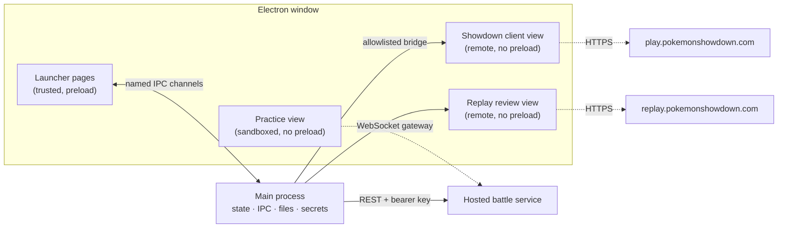

# Showdown Desktop: design

This document describes what Showdown Desktop is, how it is built, and why. It is the single reference for the app. Everything about the practice bots lives in [bots.md](bots.md).
## Contents

1. [Summary](#1-summary)
2. [Features](#2-features)
3. [Architecture](#3-architecture)
4. [Key decisions](#4-key-decisions)
5. [Security and privacy](#5-security-and-privacy)
6. [Testing](#6-testing)
7. [Build, packaging and release](#7-build-packaging-and-release)
8. [Appendix: visual design](#8-appendix-visual-design)

## 1. Summary

Showdown Desktop is a free, open-source Electron app for Windows that hosts the **unmodified** official Pokémon Showdown client and adds tools around it.

A browser tab gives Showdown no stable home for tools, and offers no safe way to practise against bots: automated play on the public server would use a real account and the public ladder. The app keeps the client and its tools in one window and keeps practice entirely off the public server.

**Audience.** Existing Showdown players, especially Showdex users, who want a dedicated, dependable app. The bar is a clean, reliable integration rather than a bundle of add-ons. There is no subscription, launcher account or paid AI API.

## 2. Features

### Overview
- Overhaul of the Showdown **UI** and **navigation**
- Pinned Showdex **damage calculator**
- **Replay notes**, with in-app replay review and backup/restore
- Game **analysis** against an engine's expected best play
- **Practice** battles against **Laplace** and **Foul Play**, two top ladder engines

### Showdown client
- Official `play.pokemonshowdown.com` client in a persistent partition; sign-in survives restarts.
- Injected theme follows Appearance; type, HP and stat colors are never restyled.
- External links open in the system browser; only Google sign-in may open a popup.

### Showdown overhaul
- **Rail:** Home, Showdown, Stats, Practice, Replay notes, Settings, account at the foot. Open rooms are listed with close buttons and **Join a room**.
- **Battles persist** across page changes. A new battle takes focus; Home shows **Return to battle**; an ended battle offers **Save replay note**, **Close battle**, **Battle again**.
- **Home:** format and team pickers, **Battle**, **Cancel**, **Challenge a user**, the format's rating, win rate, record and GXE, plus news, replay notes, friends and chat rooms.
- **Stats:** ladder totals and a sortable per-format table; **Play** preselects a format, never starts a search.
- **Restyled rooms:** Ladder, Teambuilder, Community, chat, battle and tournament rooms restyled by CSS only (`app/client-*.css`). All rules are scoped to `sd-launcher-shell`, so the stock client returns if the bridge stops.
- **Format picker:** the client's own picker shown as a centered modal.
- **Friends:** presence refreshed at most every 30 s.

### Showdex
- `npm run build:showdex` builds Showdex 1.4.2 at a pinned revision and verifies every asset against a SHA-256 manifest.
- Enabled in Settings, then an explicit client reload; a battle is never reloaded automatically. Failure leaves normal play intact.
- Excluded from packages until its distribution licensing is decided.

### Replay notes
- **Notes:** a replay link plus title, format and notes. **Save replay note** on a battle prefills players and format; it never uploads.
- **Limits:** title 120 chars, notes 5,000, 1,000 notes / 8 MiB.
- **Search** over titles, formats and notes. **Ctrl+F** search, **Esc** clear, **Ctrl+S** save. Drafts survive navigation.
- **Review:** the official replay page opens beside the note, locked to that one replay. Showdown's player does all playback.
- **Backup:** **Export** to versioned JSON; **Import** previews new / unchanged / conflict notes (existing kept by default) and applies in one atomic write. **Undo import** works for the current session only.

### Analysis
Reviews a finished game turn by turn and shows where the player's choices differed from an engine's.

- **Input:** a just-finished practice or online battle, or a saved replay note. The analysis reads the battle's protocol log, never a live battle.
- **Scope:** Gen 9 Random Battle only, the format the bots play.
- **Fair view:** each decision is judged only on what the player could see at that point. The engine fills in hidden information the same way the bots do (determinization), so it never uses the opponent's revealed team.
- **Per decision:** the engine's top choices with their search share, the player's actual choice, and a verdict:

| Verdict | Rule |
| --- | --- |
| Best | Player's choice is the engine's top pick |
| Good | Within 75% of the top pick's share |
| Inaccuracy | 25–75% of the top pick's share |
| Mistake | Under 25%, or not considered |

- **Summary:** agreement rate, a count of each verdict, and the biggest mistakes linked to their turns. Thresholds are starting values to tune.
- **Viewer:** the replay player beside a turn list. Selecting a turn jumps playback there and shows its verdict.
- **Engine:** Laplace by default, Foul Play as an option. The engine runs through the bot API (below).
- **Results** are cached with the replay note so a game is analysed once.
- **Privacy:** only the battle log is sent to the bot API, with no account details. Analysing an online game never acts on the account.

### Bot API (practice and analysis)
- **Remote by default.** The client calls a hosted bot API for every bot move, in practice and analysis. No bot code runs on the player's PC.
- **Optional local bots.** The player can install the bots from inside the app (an **Install bots** button) and choose to run them locally instead.
- **Not bundled.** The bots are too large for the base release, so they are downloaded only on request and verified against a pinned manifest before use.
- **Analysis endpoint (planned):** `POST /v1/analyze` with the battle log up to a decision, the player's side and the engine; it returns ranked choices and search shares. It is stateless and needs no simulator session.
- Protocol, limits and deployment: [bots.md](bots.md).

### Practice
- Gen 9 Random Battle against **Laplace** or **Foul Play**, on a private simulator, never the public server.
- Presets set search threads only: **Quiet** 1, **Balanced** 2, **Full** 8 (default).
- Moves, switches, Tera, Forfeit, **Next battle** and **Stop practice**. Status shows thinking, turn, time and result.
- Practice and online games stay loaded side by side; the online account is never used.

### Settings
- Appearance, start page, close protection for battles and searches, client reload, open logs, bot location (hosted or local, once installed).
- **Sign out** clears the Showdown partition, local teams included. **Reset launcher** clears settings and replay notes but keeps the session. Both confirm first.
- Window size, position and maximized state are remembered.

## 3. Architecture

One Electron 45 window (Node 24) hosts four kinds of web content with different trust. The main process owns all state, files, child processes and secrets.



| Part | Where | Trust and isolation |
| --- | --- | --- |
| Main process (`app/main.js`) | Electron main | Windows, IPC, settings, replay storage, logs, practice lifecycle, service key |
| Launcher pages (`renderer/*.html`) | `BrowserWindow` | `window.desktop` from `app/preload.js`; every call is a named, validated IPC channel |
| Showdown client | `WebContentsView`, partition `persist:showdown` | No preload, no Node; themed by injected CSS; popups only for Google sign-in |
| Showdown bridge (`app/showdown.js`) | Main, runs functions in the client page | Reads a sanitized snapshot; sends allowlisted actions |
| Replay review (`app/replay-review.js`) | `WebContentsView`, nonpersistent `replay-review` session | No preload, no Node; locked to the saved replay's path |
| Showdex (`app/showdex-integration.js`) | Custom scheme inside the client view | Optional, pinned, SHA-256-verified |
| Practice view (`app/practice-view.js`) | `WebContentsView` | Patched classic client; no preload, no Node; reaches only its session |
| Hosted practice (`app/hosted-practice.js`) | Main ↔ `scripts/bots/service.cjs` | One simulator and one bot per session on the server ([bots.md](bots.md)) |

### The Showdown bridge

Launcher pages ask main for a snapshot. Main runs `readClient()` inside the client page and sanitizes the result (IDs by regex, length-capped strings, checked sprite paths) into user, formats, teams, news, rooms and friends. Actions go the other way: search, cancel, challenge, join, focus-room, leave-room, edit-team, login, sounds, options. Each is validated against an allowlist, and arguments travel as JSON, never spliced into code. A session read sets `html.sd-launcher-shell` only when every client hook the shell needs exists. Otherwise the class is withdrawn and Showdown's own header and tabs come back (G2).

### Storage

| Data | Location | Notes |
| --- | --- | --- |
| Settings, window state | Electron userData (`%APPDATA%\showdown-desktop`) | Atomic writes (temp file, then rename) |
| Replay notes | userData `replays.json` | Versioned; a corrupt file is reported and never overwritten |
| Showdown login, teams, preferences | Partition `persist:showdown` | Separate from launcher data |
| Logs | userData | Fixed event names and numeric codes only |

`SHOWDOWN_DESKTOP_USER_DATA` selects an alternate profile for isolated tests.

### Repository layout

| Path | Contents |
| --- | --- |
| `app/` | Main-process modules, preload, injected client, replay and Showdex CSS |
| `renderer/` | Launcher pages (Home, Showdown, Practice, Replays, Settings), shared nav and styles |
| `scripts/bots/`, `scripts/laplace/` | Battle service, bot adapters, simulator wrapper, runtime builders, benchmark |
| `vendor/laplace/`, `vendor/showdex/` | Source pins, licenses, locks, patched practice client shell |
| `deploy/bots/` | Service Dockerfile, Compose file, Caddyfile |
| `tests/` | Unit tests, Python runner tests, Electron desktop and live drivers |
| `docs/` | This document and [bots.md](bots.md) |

## 4. Key decisions

| # | Decision | Alternative | Rationale |
| --- | --- | --- | --- |
| D1 | Host the unmodified official client | Fork or re-implement it | Stays current with Showdown; added layers can fail without breaking play (G2) |
| D2 | Reach the client only through a sanitized, allowlisted bridge from main | Give remote views a preload or Node | The client is remote content; a fixed list of named actions bounds the attack surface |
| D3 | Separate `persist:showdown` partition | Share launcher storage | Sign-in survives restarts; Sign out and Reset launcher clear one without the other |
| D4 | Launcher-owned room navigation, with a fail-safe | Keep Showdown's own tabs | One consistent rail; if client hooks change, the client's tabs return automatically |
| D5 | Replay notes store links, not replays | Download replay archives | Showdown hosts replays; local data stays small, private and portable |
| D6 | Import reviews conflicts and keeps existing notes by default | Overwrite or mirror the backup | Restoring must never silently lose notes |
| D7 | Bots are a hosted API by default; local bots are an optional in-app install | Bundle bots with every release | Owner decision (2026-11-13): the bots are too large for the base release, and the hosted API serves everyone regardless of CPU. Players who want to can install and run them locally |
| D8 | Practice on a private simulator with loopback enforced twice | Bot plays on the public server | Automated play on real accounts is impossible by construction ([bots.md §3.4](bots.md#34-network-confinement)) |
| D9 | Presets are thread counts | Named difficulty levels | That is all they change; strength is not measured |
| D10 | Every third-party input pinned by revision or hash | Track upstream | Reproducible builds and a recorded license position per component |

Bot-internal decisions (thread pools, rejected-choice handling, pooling) are recorded in [bots.md](bots.md).

## 5. Security and privacy

- **No automated play on real accounts.** The app and its tests never search, challenge or play on the user's account. Live tests are guest-only and spectate.
- **Least privilege per view.** Only launcher pages have a preload. Remote views are sandboxed and context-isolated and deny permissions; downloads and popups are blocked.
- **Validated IPC.** Every privileged request is validated in main. The renderer never supplies file paths (native dialogs choose them) or replay URLs (main resolves them from note IDs).
- **Text, not HTML.** Imported and snapshot text is rendered as text.
- **Private logs.** Fixed event names and numeric codes only: no usernames, credentials, replay URLs or note text.
- **Service secrets.** The operator key stays in main. Session URLs are capability tokens and are never access-logged.
- **Explicit destructive actions.** Sign out, reset, discarding drafts and undoing imports all confirm first.

## 6. Testing

| Command | Covers |
| --- | --- |
| `npm run check` | Syntax |
| `npm test` | Unit tests: bridge sanitization, action validation, navigation timing, settings, replay storage and imports, practice manifest and runtime, bot service and integrity |
| `npm run test:desktop` | Electron suites with temporary profiles and simulated Showdown responses (outbound client traffic blocked): connection recovery, view survival and sizing, themes, battle auto-switch, replay notes, review and import. Screenshots go to `out/desktop-smoke/` |
| `npm run test:shell:live` | Guest, spectate-only drift check of the client hooks the shell depends on. Run before each release |
| `npm run test:showdex:live`, `npm run test:replays:live` | Guest-only checks of a real Showdex build and a real public replay, in both themes and sizes |
| `npm run smoke:packaged` | The unpacked package with a fresh profile, system-only PATH and the public client blocked |
| Bot suites | Real games against both bots, directly and through the service ([bots.md §8](bots.md#development-and-self-hosting-harness)) |

No suite verifies a signed-in account. Those checks are manual and owner-only (section 9).

## 7. Build, packaging and release

**Run from source** (Node.js 24):

```sh
npm install
npm start
```

For Showdex, run `npm run build:showdex`, then enable it in Settings and reload the client.

**Packaging** (`electron-builder` 26.18.0, always `--publish never`):

```sh
npm run build:practice   # required: packages bundle the Laplace test runtime
npm run pack:win:dir     # unpacked app for inspection
npm run smoke:packaged
npm run smoke:practice-packaged
npm run pack:win         # unsigned per-user x64 NSIS installer in out/windows/
```

- **Installer:** adds a Start menu shortcut but no desktop shortcut, and uses Electron's default icon until branding is decided.
- **`app.asar`:** contains `app/`, `renderer/`, `package.json` and Showdex source metadata only. It never contains tests, scripts, `out/`, credentials or the Showdex runtime.
- **Bots are not in the base release** (D7); they install from the app on request. Until the installer exists, packaging still bundles the Laplace test runtime as below.
- **Laplace test runtime:** ships outside the archive under `resources/practice` and `resources/practice-adapter`. Before- and after-pack hooks re-verify every file, and packaging fails on any drift. When signing arrives, exclude the locked Python and Torch binaries from re-signing so the integrity gate still passes.
- **Dependency audit:** reports a moderate `minimatch` advisory through electron-builder. It is a development-only dependency and is absent from the app.

**Release path**, in order. Nothing is published, and there is no updater yet.

1. Prove a clean Windows 11 install, upgrade between two versions, uninstall and reinstall, as a standard user at 100% and 125% scaling.
2. Decide the project license, Showdex inclusion and the AGPL/GPL source obligations.
3. Settle app identity (icon, publisher name) and code signing.
4. Build reproducible, versioned GitHub Releases with checksums, notices and install notes.
5. Run an invited alpha with 8–12 Showdex users, fix launch, data-loss and battle-interruption defects, then publish a public alpha.
6. Add automatic updates once manual upgrades are proven. Never restart during a battle.

## 8. Appendix: visual design

Two themes share one identity: a cobalt rail, a cobalt Home hero and a Showdown-yellow primary button. Light is **Cobalt**; dark is **Steel blue**, deliberately blue rather than charcoal or grey. Components use role tokens only. A color change edits both theme blocks of `renderer/styles.css` and the matching `--sd-*` value in `app/client-theme.css`.

| Token | Cobalt (light) | Steel blue (dark) | Use |
| --- | --- | --- | --- |
| `--bg-app` | `#e6ecf5` | `#24304a` | Window background |
| `--bg-panel` | `#ffffff` | `#2c3a57` | Panels and cards |
| `--text` | `#15223a` | `#f1f4fa` | Primary text |
| `--accent` | `#2459b8` | `#7db2ff` | Links, focus, selection |
| `--primary` | `#f5c42c` | `#f5c42c` | One primary button per region |
| `--rail-bg` | `#1f4b9a` | `#193f85` | Navigation rail |

Rules: flat and dense; color always has a job; no purple, gradients, glassy buttons or web fonts; waiting states animate, with reduced motion respected. Pokémon type, HP, stat and damage colors are never restyled. Subjective visual changes are mocked up as 2–3 options for the owner to choose from before they are built.
