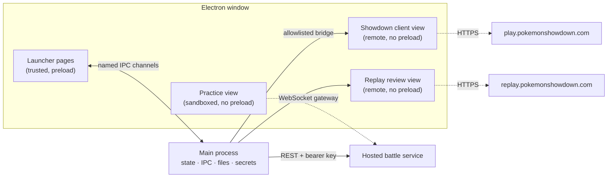

# Showdown Desktop: design

| | |
| --- | --- |
| **Status** | Living document. Describes v0.2.0. |
| **Owner** | Jayden |
| **Last reviewed** | 2026-11-12 |
| **Companion** | [bots.md](bots.md): how Foul Play and Laplace work, their protocols, performance and hosting |

This document describes what Showdown Desktop is, how it is built, and why. It is the single reference for the app. Everything about the practice bots lives in [bots.md](bots.md). Figures marked *(snapshot)* were true on the date above.

## Contents

1. [Summary](#1-summary)
2. [Goals and non-goals](#2-goals-and-non-goals)
3. [Architecture](#3-architecture)
4. [Features](#4-features)
5. [Key decisions](#5-key-decisions)
6. [Security and privacy](#6-security-and-privacy)
7. [Testing](#7-testing)
8. [Build, packaging and release](#8-build-packaging-and-release)
9. [Status, risks and open questions](#9-status-risks-and-open-questions)
10. [Appendix: visual design](#10-appendix-visual-design)

## 1. Summary

Showdown Desktop is a free, open-source Electron app for Windows that hosts the **unmodified** official Pokémon Showdown client and adds tools around it:

- a launcher shell with a Home hub and room navigation;
- replay notes, with in-app replay review and backup/restore;
- an optional pinned Showdex damage calculator;
- practice battles against two strong bots, **Laplace** and **Foul Play**, on a private hosted battle service.

A browser tab gives Showdown no stable home for tools, and offers no safe way to practise against bots: automated play on the public server would use a real account and the public ladder. The app keeps the client and its tools in one window and keeps practice entirely off the public server.

**Audience.** Existing Showdown players, especially Showdex users, who want a dedicated, dependable app. Demand is unproven and alternatives exist, so the bar is a clean, reliable integration rather than a bundle of add-ons. There is no subscription, launcher account or paid AI API.

## 2. Goals and non-goals

**Goals**

- **G1.** A Windows app that players download, install and launch without developer tools.
- **G2.** The official client stays fully playable at all times. Every added layer fails safe back to plain Showdown.
- **G3.** Useful tools around the client: Home hub, replay notes and review, optional calculator.
- **G4.** Practice against strong engines through a private hosted service, never touching the player's account.
- **G5.** A distinctive identity: cobalt light and steel-blue dark themes, flat and colorful.

**Non-goals**

- Forking or re-implementing the Showdown client or simulator.
- Automated play on a real account. The app never searches, challenges or plays by itself; tests use simulated sessions.
- Running bots on the player's computer as a feature. The direct local path in the code is a test harness and the base for self-hosting only ([bots.md §8](bots.md#development-and-self-hosting-harness)).
- Hosting replays (Showdown hosts them), cloud accounts or sync, an extension marketplace, AI analysis.
- Difficulty ratings for bots. Presets are CPU budgets.

**Priority.** Features first; installer validation, signing, licensing and public release last.

## 3. Architecture

One Electron 45 window (Node 24) hosts four kinds of web content with different trust. The main process owns all state, files, child processes and secrets.



| Part | Where | Trust and isolation |
| --- | --- | --- |
| Main process (`app/main.js`) | Electron main | Windows, IPC, settings, replay storage, logs, practice lifecycle, service key |
| Launcher pages (`renderer/*.html`) | `BrowserWindow` | `window.desktop` from `app/preload.js`; every call is a named, validated IPC channel |
| Showdown client | `WebContentsView`, partition `persist:showdown` | No preload, no Node; themed by injected CSS; popups only for Google sign-in |
| Showdown bridge (`app/showdown.js`) | Main, runs functions in the client page | Reads a sanitized snapshot; sends allowlisted actions |
| Replay review (`app/replay-review.js`) | `WebContentsView`, nonpersistent `replay-review` session | No preload, no Node; locked to the saved replay's path |
| Showdex (`app/showdex-integration.js`) | Custom scheme inside the client view | Optional, pinned, SHA-256-verified |
| Practice view (`app/practice-view.js`) | `WebContentsView` | Patched classic client; no preload, no Node; reaches only its session |
| Hosted practice (`app/hosted-practice.js`) | Main ↔ `scripts/bots/service.cjs` | One simulator and one bot per session on the server ([bots.md](bots.md)) |

### The Showdown bridge

Launcher pages ask main for a snapshot. Main runs `readClient()` inside the client page and sanitizes the result (IDs by regex, length-capped strings, checked sprite paths) into user, formats, teams, news, rooms and friends. Actions go the other way: search, cancel, challenge, join, focus-room, leave-room, edit-team, login, sounds, options. Each is validated against an allowlist, and arguments travel as JSON, never spliced into code. A session read sets `html.sd-launcher-shell` only when every client hook the shell needs exists. Otherwise the class is withdrawn and Showdown's own header and tabs come back (G2).

### Storage

| Data | Location | Notes |
| --- | --- | --- |
| Settings, window state | Electron userData (`%APPDATA%\showdown-desktop`) | Atomic writes (temp file, then rename) |
| Replay notes | userData `replays.json` | Versioned; a corrupt file is reported and never overwritten |
| Showdown login, teams, preferences | Partition `persist:showdown` | Separate from launcher data |
| Logs | userData | Fixed event names and numeric codes only |

`SHOWDOWN_DESKTOP_USER_DATA` selects an alternate profile for isolated tests.

### Repository layout

| Path | Contents |
| --- | --- |
| `app/` | Main-process modules, preload, injected client, replay and Showdex CSS |
| `renderer/` | Launcher pages (Home, Showdown, Practice, Replays, Settings), shared nav and styles |
| `scripts/bots/`, `scripts/laplace/` | Battle service, bot adapters, simulator wrapper, runtime builders, benchmark |
| `vendor/laplace/`, `vendor/showdex/` | Source pins, licenses, locks, patched practice client shell |
| `deploy/bots/` | Service Dockerfile, Compose file, Caddyfile |
| `tests/` | Unit tests, Python runner tests, Electron desktop and live drivers |
| `docs/` | This document and [bots.md](bots.md) |

## 4. Features

### Launcher shell and Home

- **Rail:** Home, Showdown, Stats, Practice, Replay notes and Settings, with the account at the foot. While rooms are open, a Showdown section lists them (battles, chats, teambuilder, ladder) with close buttons and a **Join a room** button. Closing an own live battle goes through the client's own leave path, so the forfeit prompt still appears.
- **Persistence:** the client stays loaded across page changes, so navigating never loses a battle. A newly started battle switches to the Showdown view and takes priority. Home shows **Return to battle** while one runs. An ended battle shows a result bar: **Save replay note**, **Close battle**, **Battle again**.
- **Home hero:** format and team pickers (with the team's sprites), **Battle**, **Cancel** and **Challenge a user**. Search runs in the background with an animated state. Choices are remembered per format as a convenience only.
- **Home hero record:** the selected format's rating, win rate, win–loss record and GXE, from the public profile endpoint (cached 2 minutes), with user and battle counts and **Edit teams** (opens the selected team).
- **Home layout:** modelled on Showdown's main menu. The hero is a launcher column on the left with Teambuilder, Ladder, Watch a battle and Your stats rows beneath it. Beside it sit titled windows: **Latest news** and **Replay notes** in the middle, **Friends** and **Chat rooms** on the right.
- **Stats page:** a rail page with ladder totals (battles, win rate, highest rating, most played) and a sortable, filterable per-format table of rating, win rate, wins, losses, battles and GXE. **Play** on a row preselects that format on Home; it never starts a search.
- **Restyled client rooms:** the Ladder, Teambuilder, Community view, chat room list, live battle list, chat rooms, battle rooms and tournaments are the client's own pages restyled in place by `app/client-ladder.css`, `client-teambuilder.css`, `client-community.css`, `client-rooms.css`, `client-chat.css` (chat and battle rooms) and `client-tournament.css` (the tournament bar, bracket, tools, notices and bracket pop-out). They change surfaces, type and layout only; the client's markup and controls are untouched, and every rule is scoped to `sd-launcher-shell` so the client's own look returns if the bridge stops driving it.
- **Friends panel:** structured presence (online, idle, busy, offline as reported), refreshed at most every 30 s. **Open friends list** is the fallback. No battle state or avatars are inferred.

### Showdown client

- The official `play.pokemonshowdown.com` client in a persistent partition, so sign-in survives restarts.
- The injected theme follows Appearance and preserves Pokémon type, HP and stat colors.
- External links open in the system browser. Only Google sign-in may open a popup.

### Replay notes

- **Notes:** paste a link from Showdown's **Upload and share replay**, add a title, format and notes, and save. **Save replay note** on a battle prefills players and format but never uploads. Private links keep their access suffix.
- **Limits:** title 120 characters, notes 5,000, collection 1,000 entries / 8 MiB. Saved links are read-only. Adding a duplicate link offers the existing note.
- **Search and shortcuts:** search matches titles, formats and note text. **Ctrl+F** focuses search, **Escape** clears it, **Ctrl+S** saves.
- **Drafts:** unsaved drafts survive navigation. Closing the app with a draft asks before discarding it. Deleting a note never touches the hosted replay.

**Replay review.** **Review replay** opens the official replay page beside the same note editor. Showdown's player provides all playback; the app reconstructs nothing.
- **Controls:** **Hide notes** widens the player. **Reload replay** reloads only the replay. **Back to notes** closes the player and stops audio. **Open in browser** is explicit.
- **Locked to one replay:** main resolves the note ID to its validated URL; the renderer never supplies a URL. Navigation is limited to that exact replay path plus upstream playback parameters. If the page moves to a different replay, the view stops.
- **Failures and limits:** network, HTTP and renderer failures show an error with an explicit reload. Playback position is not kept.

**Backup and restore.**
- **Export notes…** writes every saved note (ignoring filters, excluding drafts) to versioned JSON through a native Save dialog. It refuses destinations inside the live profile, and a failed write keeps the previous file.
- **Import notes…** reads a file into a validated snapshot and opens a review window:

| Result | Meaning | Default |
| --- | --- | --- |
| New | No saved note has this exact link | Added with its saved dates |
| Unchanged | Link, title, format and notes all match | Skipped |
| Conflict | Same link, different content | Keep existing; per-note or bulk **Use imported** |

- **Applying an import:** it is one atomic write, and notes missing from the file are always kept.
- **What blocks it:** the file must pass validation as a whole (version 1, ≤ 8 MiB, no duplicates, valid URLs and dates); nothing is truncated or silently skipped. A preview goes stale if saved notes change meanwhile, and an open draft must be saved first.
- **Undo import…** restores the collection from before the last import that changed notes. It is available only within the app session and only while notes are unchanged. Session undo is not a backup history.

### Practice

- **Opponents and presets:** Gen 9 Random Battle against **Laplace** or **Foul Play**, on the private hosted battle service. Presets set search threads only: **Quiet** 1, **Balanced** 2, **Full** 8 (default).
- **Controls:** moves, switches, Terastallization, Forfeit, **Next battle** (rematch) and **Stop practice…**. Status shows starting, ready, thinking, turn, elapsed time and result.
- **Account separation:** practice and online games stay loaded side by side, and the online account is never involved.
- How the bots decide, every protocol layer, performance and deployment: [bots.md](bots.md).

### Showdex (optional)

- **Build:** `npm run build:showdex` checks out Showdex 1.4.2 at a pinned revision and applies a recorded readiness patch. It verifies every asset against a committed SHA-256 manifest. Sources and the AGPL-3.0 license are in `vendor/showdex/SOURCE.md`.
- **Enabling:** turn it on in Settings, then reload the client explicitly; a battle is never reloaded automatically. Status reads Loaded only after Showdex has rendered. A failure leaves normal play intact.
- **Look:** its chrome follows Appearance; calculator behavior and game colors stay upstream. It is excluded from packages until its distribution licensing is decided.

### Settings

- **Options:** Appearance (system, light, dark), start page, close protection for battles and searches, explicit client reload, open logs.
- **Sign out** clears the Showdown partition, including local teams (export them first). **Reset launcher** clears settings, preferences and replay notes but keeps the Showdown session. Both confirm first.
- **Window:** size, position and maximized state are remembered. A saved window is repositioned if its monitor is gone.

## 5. Key decisions

| # | Decision | Alternative | Rationale |
| --- | --- | --- | --- |
| D1 | Host the unmodified official client | Fork or re-implement it | Stays current with Showdown; added layers can fail without breaking play (G2) |
| D2 | Reach the client only through a sanitized, allowlisted bridge from main | Give remote views a preload or Node | The client is remote content; a fixed list of named actions bounds the attack surface |
| D3 | Separate `persist:showdown` partition | Share launcher storage | Sign-in survives restarts; Sign out and Reset launcher clear one without the other |
| D4 | Launcher-owned room navigation, with a fail-safe | Keep Showdown's own tabs | One consistent rail; if client hooks change, the client's tabs return automatically |
| D5 | Replay notes store links, not replays | Download replay archives | Showdown hosts replays; local data stays small, private and portable |
| D6 | Import reviews conflicts and keeps existing notes by default | Overwrite or mirror the backup | Restoring must never silently lose notes |
| D7 | Bots run only on the hosted service for players | Also on the player's PC | Owner decision (2026-11-12): results don't depend on the player's CPU, and one deployment serves everyone. The direct path stays for testing and self-hosting |
| D8 | Practice on a private simulator with loopback enforced twice | Bot plays on the public server | Automated play on real accounts is impossible by construction ([bots.md §3.4](bots.md#34-network-confinement)) |
| D9 | Presets are thread counts | Named difficulty levels | That is all they change; strength is not measured |
| D10 | Every third-party input pinned by revision or hash | Track upstream | Reproducible builds and a recorded license position per component |

Bot-internal decisions (thread pools, rejected-choice handling, pooling) are recorded in [bots.md](bots.md).

## 6. Security and privacy

- **No automated play on real accounts.** The app and its tests never search, challenge or play on the user's account. Live tests are guest-only and spectate.
- **Least privilege per view.** Only launcher pages have a preload. Remote views are sandboxed and context-isolated and deny permissions; downloads and popups are blocked.
- **Validated IPC.** Every privileged request is validated in main. The renderer never supplies file paths (native dialogs choose them) or replay URLs (main resolves them from note IDs).
- **Text, not HTML.** Imported and snapshot text is rendered as text.
- **Private logs.** Fixed event names and numeric codes only: no usernames, credentials, replay URLs or note text.
- **Service secrets.** The operator key stays in main. Session URLs are capability tokens and are never access-logged.
- **Explicit destructive actions.** Sign out, reset, discarding drafts and undoing imports all confirm first.

## 7. Testing

| Command | Covers |
| --- | --- |
| `npm run check` | Syntax |
| `npm test` | Unit tests: bridge sanitization, action validation, navigation timing, settings, replay storage and imports, practice manifest and runtime, bot service and integrity |
| `npm run test:desktop` | Electron suites with temporary profiles and simulated Showdown responses (outbound client traffic blocked): connection recovery, view survival and sizing, themes, battle auto-switch, replay notes, review and import. Screenshots go to `out/desktop-smoke/` |
| `npm run test:shell:live` | Guest, spectate-only drift check of the client hooks the shell depends on. Run before each release |
| `npm run test:showdex:live`, `npm run test:replays:live` | Guest-only checks of a real Showdex build and a real public replay, in both themes and sizes |
| `npm run smoke:packaged` | The unpacked package with a fresh profile, system-only PATH and the public client blocked |
| Bot suites | Real games against both bots, directly and through the service ([bots.md §8](bots.md#development-and-self-hosting-harness)) |

No suite verifies a signed-in account. Those checks are manual and owner-only (section 9).

## 8. Build, packaging and release

**Run from source** (Node.js 24):

```sh
npm install
npm start
```

For Showdex, run `npm run build:showdex`, then enable it in Settings and reload the client.

**Packaging** (`electron-builder` 26.18.0, always `--publish never`):

```sh
npm run build:practice   # required: packages bundle the Laplace test runtime
npm run pack:win:dir     # unpacked app for inspection
npm run smoke:packaged
npm run smoke:practice-packaged
npm run pack:win         # unsigned per-user x64 NSIS installer in out/windows/
```

- **Installer:** adds a Start menu shortcut but no desktop shortcut, and uses Electron's default icon until branding is decided.
- **`app.asar`:** contains `app/`, `renderer/`, `package.json` and Showdex source metadata only. It never contains tests, scripts, `out/`, credentials or the Showdex runtime.
- **Laplace test runtime:** ships outside the archive under `resources/practice` and `resources/practice-adapter`. Before- and after-pack hooks re-verify every file, and packaging fails on any drift. When signing arrives, exclude the locked Python and Torch binaries from re-signing so the integrity gate still passes.
- **Dependency audit:** reports a moderate `minimatch` advisory through electron-builder. It is a development-only dependency and is absent from the app.

**Release path**, in order. Nothing is published, and there is no updater yet.

1. Prove a clean Windows 11 install, upgrade between two versions, uninstall and reinstall, as a standard user at 100% and 125% scaling.
2. Decide the project license, Showdex inclusion and the AGPL/GPL source obligations.
3. Settle app identity (icon, publisher name) and code signing.
4. Build reproducible, versioned GitHub Releases with checksums, notices and install notes.
5. Run an invited alpha with 8–12 Showdex users, fix launch, data-loss and battle-interruption defects, then publish a public alpha.
6. Add automatic updates once manual upgrades are proven. Never restart during a battle.

## 9. Status, risks and open questions

**Status** *(snapshot)*

| Area | State |
| --- | --- |
| Shell, Home, client, replay notes, review, backup, Showdex, settings | Implemented; automated suites pass |
| Practice bots | Implemented through the service and the harness; the Linux image and real HTTPS deployment are untested |
| Windows installer | Builds and passes packaged smoke tests; never tested on a clean machine |
| Public release | Not started |

**Risks**

| Risk | Effect | Mitigation |
| --- | --- | --- |
| Showdown client changes | Bridge reads or theme selectors break; a switch to Showdown's new Preact client would need a bridge rewrite | Fail-safe shell; `test:shell:live` before releases |
| Licensing | AGPL/GPL obligations for the patched client, Foul Play and Showdex | Source and notices retained; owner review before release |
| Service capacity | Fewer CPUs mean shallower searches; one replica; shared key | Measure the VM; private testers only; per-user credentials before any public service |
| Unproven demand | Users may not return | Invited alpha measures return use before more features |

**Open decisions (owner)**

- [ ] Project license, and distribution of the patched AGPL client, GPL Foul Play and Showdex.
- [ ] Code signing and release branding.
- [ ] Whether Showdex ships in packages.
- [ ] How invited testers get service access.

**Verification outstanding**

- [ ] Signed-in checks by the owner: session persistence, ratings, team selection, challenges, a real search becoming a battle, friends data, rail forfeit prompt, result bar.
- [ ] Clean-machine install, upgrade and uninstall (release step 1).
- [ ] Linux image and a real HTTPS deployment of the battle service.

**Not designed yet:** incoming challenges and PMs inside the launcher, a replacement for Showdown's own home screen, Practice view chrome, practice formats beyond Gen 9 Random Battle, macOS and Linux packages.

## 10. Appendix: visual design

Two themes share one identity: a cobalt rail, a cobalt Home hero and a Showdown-yellow primary button. Light is **Cobalt**; dark is **Steel blue**, deliberately blue rather than charcoal or grey. Components use role tokens only. A color change edits both theme blocks of `renderer/styles.css` and the matching `--sd-*` value in `app/client-theme.css`.

| Token | Cobalt (light) | Steel blue (dark) | Use |
| --- | --- | --- | --- |
| `--bg-app` | `#e6ecf5` | `#24304a` | Window background |
| `--bg-panel` | `#ffffff` | `#2c3a57` | Panels and cards |
| `--text` | `#15223a` | `#f1f4fa` | Primary text |
| `--accent` | `#2459b8` | `#7db2ff` | Links, focus, selection |
| `--primary` | `#f5c42c` | `#f5c42c` | One primary button per region |
| `--rail-bg` | `#1f4b9a` | `#193f85` | Navigation rail |

Rules: flat and dense; color always has a job; no purple, gradients, glassy buttons or web fonts; waiting states animate, with reduced motion respected. Pokémon type, HP, stat and damage colors are never restyled. Subjective visual changes are mocked up as 2–3 options for the owner to choose from before they are built.
